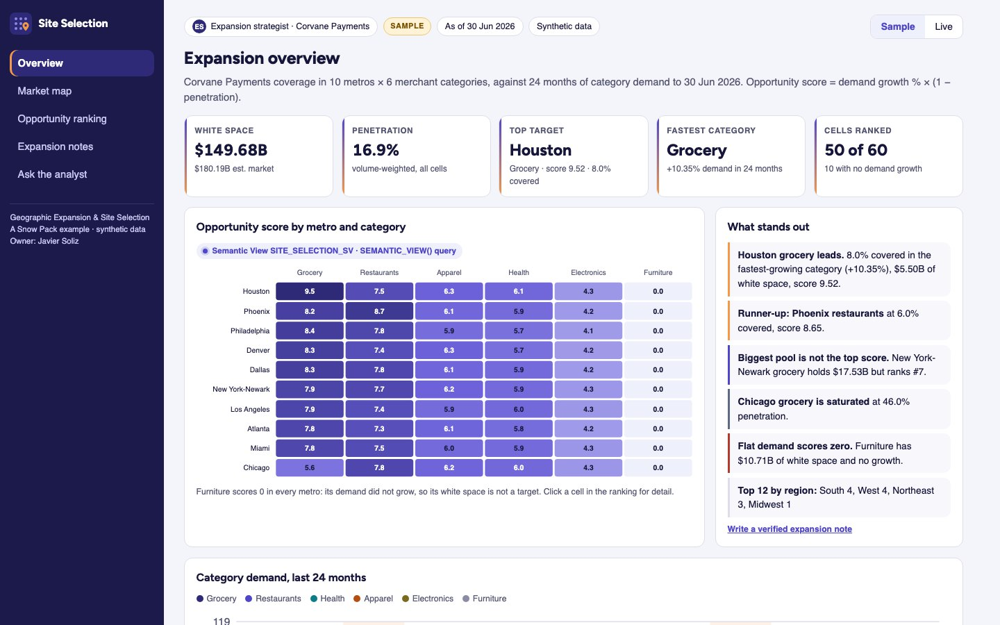

# Geographic Expansion & Site Selection

Decide which metro and merchant category to grow into next: rank every metro × merchant-category
cell by white-space opportunity, where category demand is growing but your merchant coverage is
still thin, on governed Snowflake data, and write an expansion note that a second AI pass fact-checks.

Owner: Javier Soliz · Last reviewed: November 2026

- **Try it, no account:** https://sfc-gh-jsoliz.github.io/sfguide-site-selection/try/
- **Guide:** https://sfc-gh-jsoliz.github.io/sfguide-site-selection/



## What it shows

A payments processor's go-to-market team has budget for a few new markets. The biggest pool of
volume is the obvious pick, but a big pool you already cover, or a category that isn't growing,
is a poor bet. The app ranks every metro × merchant-category cell by a computed
**opportunity score** and shows where to go:

- **Overview:** white space, volume-weighted penetration, the top target, the fastest-growing
  category and how many cells rank at all; a metro × category heat map of the score; 24 months
  of category demand.
- **Market map:** a dot-map of the contiguous US with each metro sized by white-space dollars and
  colored by region, region totals, and a panel per metro.
- **Opportunity ranking:** all 60 cells on a penetration vs demand-growth scatter and in a
  sortable, filterable table with Top target, Saturated and No-growth status; a panel per cell
  shows the score worked out on its own numbers.
- **Expansion notes:** Cortex `AI_COMPLETE` drafts a one-page note from a ranked fact pack, citing
  every figure (`[F1]`…), then a second `AI_COMPLETE` call checks it and stamps it **Verified**
  or **Needs review**. "Try to break it" adds a hedged forecast and reruns only the verifier.
- **Ask the analyst:** a Cortex Agent answers plain-English questions with Cortex Analyst over the
  semantic view, and shows the SQL it ran.

`opportunity_score = max(category demand growth %, 0) × (1 − penetration)`. It is an index, not
dollars: New York grocery has the most white space ($17.53B) but ranks 7th. The planted data
stories are listed in [`data/README.md`](data/README.md).

## Prerequisites

- A Snowflake account (Enterprise Edition or higher) in a region with Cortex AI (`AI_COMPLETE`,
  Cortex Agents, Cortex Analyst), or with cross-region inference enabled. The app uses
  `claude-sonnet-4-5`; change `MODEL` in `app/streamlit_app.py` if your account differs.
- ACCOUNTADMIN (or USERADMIN + SECURITYADMIN) and SYSADMIN to run `sql/setup.sql`, which creates
  a least-privilege role, a database and an XSMALL warehouse.
- To run the app locally: Python 3.11+ and `pip install -r app/requirements.txt`.
- Optional, for real demand data: the free **Financial Data Package** listing from Snowflake
  Marketplace (`SNOWFLAKE_PUBLIC_DATA_FINANCIAL_PACKAGE`).

## Quick start: no account (Sample mode)

Open the hosted example: https://sfc-gh-jsoliz.github.io/sfguide-site-selection/try/. It shows
all five screens on data captured from a Live run. AI text is labeled **Sample AI response** and
replayed with a 4–8 s simulated delay.

Or run the Streamlit app locally on the same bundled data:

```bash
pip install -r app/requirements.txt
streamlit run app/streamlit_app.py
```

With no Snowflake settings the app opens in Sample mode. Choosing Live without a connection shows
what to set; it never falls back to sample data silently.

## Run it live

1. **Setup.** Run [`sql/setup.sql`](sql/setup.sql) top to bottom in a Snowsight worksheet. It
   takes about 15 s and builds everything on synthetic data, so no listing is needed.
2. **Optional, real demand.** Get the free Financial Data Package listing, grant the pack role
   access (see the header of the script), then run [`sql/setup_census.sql`](sql/setup_census.sql).
   Category demand becomes real US Census Advance Retail Sales and the data mode becomes `hybrid`.
   Metro sizing and coverage stay synthetic. Run `sql/setup.sql` again to go back.
3. **Deploy the app in Snowflake.** Upload the `app/` files to the stage
   `SNOWPACK_SITE_SELECTION.CORE.SITE_SELECTION_APP_STAGE` (folder layout in the header of
   [`sql/deploy_streamlit.sql`](sql/deploy_streamlit.sql)), then run that script. The app lives in
   the pack database, so cleanup removes it.
4. **Or run locally in Live mode** with key-pair authentication
   ([key-pair setup](https://docs.snowflake.com/en/user-guide/key-pair-auth)). Credentials come
   from environment variables and are never collected in the browser:

   ```bash
   export SNOWFLAKE_ACCOUNT=<your_account_identifier>
   export SNOWFLAKE_USER=<YOUR_USER>
   export SNOWFLAKE_PRIVATE_KEY_PATH=~/.snowflake/keys/<your_key>.p8
   streamlit run app/streamlit_app.py
   ```

   The app connects as `SNOWPACK_SITE_SELECTION_ROLE` on `SNOWPACK_SITE_SELECTION_WH`
   (override with `SNOWFLAKE_ROLE` / `SNOWFLAKE_WAREHOUSE`).
5. **Refresh the Sample bundle** after changing data or prompts:
   `python scripts/capture_sample.py` with the same variables. It rewrites `app/sample/` and
   `docs/try/data/`.

### What gets created

| Object | Type | Purpose |
|---|---|---|
| `SNOWPACK_SITE_SELECTION_ROLE` | Role | Least-privilege role; owns everything below |
| `SNOWPACK_SITE_SELECTION_WH` | Warehouse | XSMALL, `AUTO_SUSPEND = 60` |
| `SNOWPACK_SITE_SELECTION.CORE` | Database, schema | Home for all pack objects |
| `SITE_SELECTION_MERCHANT_CATEGORY` | Table | 6 MCC-aligned categories mapped to Census codes |
| `SITE_SELECTION_METRO` | Table | 10 metros: synthetic sizing, city-centre lat/lon |
| `SITE_SELECTION_CATEGORY_DEMAND` | Table (view after `setup_census.sql`) | 24 months of category demand |
| `SITE_SELECTION_COVERAGE` | Table | Synthetic coverage per metro × category |
| `SITE_SELECTION_BENCHMARK` | View | Metro × category grain with white space and opportunity score |
| `SITE_SELECTION_DATA_SOURCE_INFO` | View | Data mode marker (`synthetic` or `hybrid`) |
| `SITE_SELECTION_SV` | Semantic view | Business meaning over the benchmark; read by the app with `SEMANTIC_VIEW()` |
| `SITE_SELECTION_REPORTS` | Table | Saved expansion notes, verdicts and fact packs |
| `SITE_SELECTION_AGENT` | Cortex Agent | Cortex Analyst over the semantic view; used by Ask the analyst |
| `SITE_SELECTION_APP_STAGE` | Stage | Streamlit app files |
| `SITE_SELECTION_APP` | Streamlit | Created by `sql/deploy_streamlit.sql` |

## Cost and time

Measured in a test account in November 2026:

| Step | Time | Cost |
|---|---|---|
| `sql/setup.sql` | 13–16 s | A small fraction of a warehouse credit (XSMALL, plus the 60 s auto-suspend) |
| Overview, map and ranking in Live mode | Seconds per screen once the warehouse is warm | Warehouse time only |
| One expansion note (draft + verify) | 9–12 s | Two `AI_COMPLETE` calls, about 0.012 AI credits |
| "Try to break it" re-verify | 3–4 s | One `AI_COMPLETE` call |
| One "Ask the analyst" answer | 13–19 s | Cortex Agent usage (billed separately) |

The whole build and test session (three setup runs, sample captures and the UI tests) used about
0.21 warehouse credits and 0.14 AI credits for 22 `AI_COMPLETE` calls. Your numbers depend on
region, model and warehouse.

## Known limitations

- Metro sizing and processor coverage are **synthetic**, so every coverage and opportunity figure
  is illustrative. Only city names and coordinates are real.
- Demand is national per category (the same growth for every metro); `setup_census.sql` makes it
  real but still national.
- `sql/setup_census.sql` was not run in our test account (the listing isn't mounted there). The
  synthetic path was verified live end to end.
- The semantic view does not allow facts together with dimensions, so the app reads each cell as
  metrics over a one-row group (SUM, MAX or a weighted ratio of one cell equals the cell).
- The verifier is itself an LLM. It catches the planted hedge and forecast reliably in testing,
  but it can still miss a subtle error or flag a correct rounding.
- The hosted example is always Sample mode: static data and replayed AI text, not live inference.
- Not a production system: review, test and adapt before real use.

## Customize with Cortex Code

Prompt Cortex Code against the objects in `SNOWPACK_SITE_SELECTION.CORE`, for example:

- "Change `opportunity_score` in `SITE_SELECTION_BENCHMARK` to weight median income and
  population so dense, high-income metros score higher, and update the semantic view."
- "Add a coverage-gap view of every metro × category with penetration below 20% and demand
  growth in the top quartile, and expose it in `SITE_SELECTION_SV`."
- "Replace `SITE_SELECTION_COVERAGE` with our settlement data by metro and MCC, keeping the same
  columns, and recapture the Sample bundle."

## Cleanup

Run [`sql/cleanup.sql`](sql/cleanup.sql). It drops the database (with the Streamlit app, stage,
agent and semantic view), the warehouse and the role, and nothing else.

## Repository layout

```
app/                     streamlit_app.py, sample/ (captured Live data), static/ (logo, font, dot-map), .streamlit/
sql/                     setup.sql, setup_census.sql, deploy_streamlit.sql, cleanup.sql
data/README.md           generator, determinism check and planted stories
scripts/                 capture_sample.py, make_dotmap.py, build_landing_map.py, check_contrast.py
docs/                    guide (index.html), hosted example (try/), DESIGN.md, images/, catalog/
notebook/                lab-site-selection.ipynb, the pattern cell by cell
index.html, try/         redirects to docs/ for older links
```

## Learn more

- [Semantic views](https://docs.snowflake.com/en/user-guide/views-semantic/overview)
- [AI_COMPLETE](https://docs.snowflake.com/en/sql-reference/functions/ai_complete)
- [Cortex Agents](https://docs.snowflake.com/en/user-guide/snowflake-cortex/cortex-agents)
- [Cortex Analyst](https://docs.snowflake.com/en/user-guide/snowflake-cortex/cortex-analyst)
- [Streamlit in Snowflake](https://docs.snowflake.com/en/developer-guide/streamlit/about-streamlit)

## License

Apache 2.0 (see [`LICENSE`](LICENSE)). An illustrative example provided as-is; not an official
Snowflake product and not supported by Snowflake Support. Contains no customer data. Corvane
Payments is fictional. Figtree font: SIL Open Font License ([`app/static/OFL.txt`](app/static/OFL.txt)).
